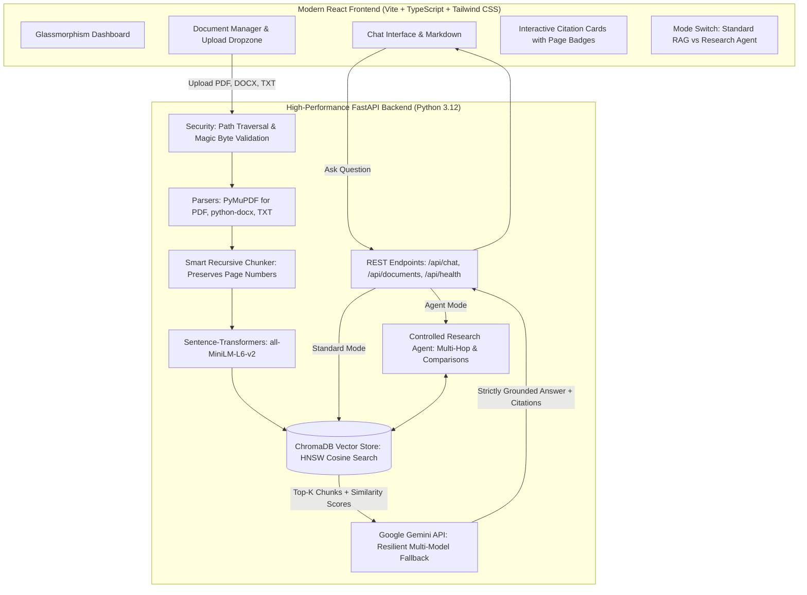

# 📚 DocuMind RAG — Document Q&A Bot with Citations & AI Research Agent

> **An enterprise-grade, full-stack Retrieval-Augmented Generation (RAG) platform that turns your PDFs, Word documents, and text files into an interactive, verifiable AI knowledge base.**

[](https://www.python.org/)
[](https://fastapi.tiangolo.com/)
[](https://react.dev/)
[](https://www.typescriptlang.org/)
[](https://www.trychroma.com/)
[](https://ai.google.dev/)
[](https://tailwindcss.com/)
[](https://pytest.org/)

---

## 💡 What is this Project? (Explained for Beginners)

Have you ever tried reading a **150-page PDF report**, a **complex legal contract**, or a **technical software manual** just to find one specific answer? 

Standard AI chatbots (like ChatGPT) have major flaws when reading private documents:
1. **They Hallucinate**: They invent convincing facts that do not exist in your file.
2. **No Verifiable Evidence**: They don't point you to the exact page where they found the information.
3. **Expensive & Slow**: Sending a massive 200-page book on every question wastes money and hits API limits.

### How DocuMind Solves This with RAG
**RAG (Retrieval-Augmented Generation)** is the industry-standard architecture used by top tech companies. 
Instead of sending your entire document to the AI:
1. DocuMind **reads and extracts** text from your PDFs, DOCX, and TXT files page by page.
2. It breaks the text into small **chunks** and converts them into mathematical numbers (**embeddings**) stored in a fast vector database (**ChromaDB**).
3. When you ask a question, it instantly retrieves **only the top 3–5 most relevant paragraphs**.
4. It feeds those exact paragraphs to **Google Gemini** with strict instructions: *"Answer ONLY based on these facts and cite the exact page numbers."*
5. If the answer is not in your uploaded documents, it tells you honestly: *"The documents do not contain sufficient information."*

---

## 🎯 How DocuMind Helps for Every Purpose

| User Group | Problem | How DocuMind Helps |
|---|---|---|
| 🎓 **Students & Researchers** | Reading 50+ research papers and textbooks before exams or literature reviews. | Ask *"What methodology was used in Chapter 3?"* and get the answer with the exact page citation. |
| 💻 **Developers & Engineers** | Searching through massive API docs, cloud architecture guides, and code standards. | Ask *"What is the SLA uptime for Tier 1 databases?"* and instantly get the spec table without digging through pages. |
| ⚖️ **Legal, HR & Operations** | Reviewing 80-page employee handbooks, non-disclosure agreements, and compliance files. | Ask *"What are the termination notice clauses?"* with direct quotes and zero risk of invented terms. |
| 💼 **Business & Analysts** | Analyzing quarterly financial statements, pitch decks, and market research reports. | Toggle **Research Agent Mode** to compare revenue, metrics, and risk factors across multiple different documents at once. |

---

## 🏗️ System Architecture



---

## ✨ Standout Features

- 📑 **Universal Document Ingestion**: Upload multiple `.pdf`, `.docx`, and `.txt` files simultaneously.
- 🎯 **Pinpoint Page Citations**: Every answer includes clickable citation cards with document names, page numbers, match percentages, and expandable quotes.
- 🤖 **Autonomous AI Research Agent**:
  - Detects conversational greetings without wasting vector queries.
  - Automatically identifies comparison questions (e.g., *"Compare REST and GraphQL"*), breaks them into sub-queries, searches each document, and synthesizes a side-by-side comparison.
  - Displays a transparent **Agent Reasoning & Retrieval Trail** in the UI.
- 🛡️ **Zero Hallucination Guarantee**: Strict system prompt safeguards against prompt injection attacks (e.g. *"ignore previous rules"*) and refuses to extrapolate beyond retrieved evidence.
- 💡 **Suggested Question Chips**: Instantly generates 3 insightful starter questions whenever a document is uploaded.
- ⚙️ **Configurable Retrieval**: Interactive slider modal to tune Top-K (1 to 10 chunks) and Similarity Score thresholds (5% to 80%).

---

## 🚀 5-Minute Quickstart Guide

### Step 1: Clone or Open the Repository
```bash
cd "d:\RAG bot"
```

### Step 2: Get a Free Google Gemini API Key
1. Go to [Google AI Studio](https://aistudio.google.com/).
2. Click **Create API Key** (it takes 10 seconds and is free).
3. Open `backend/.env` in any text editor and paste your key:
   ```env
   GEMINI_API_KEY=your_actual_gemini_api_key_here
   GEMINI_MODEL=gemini-3.5-flash-lite
   ```

---

### Step 3: Start the Backend (Terminal 1)

#### Windows:
```powershell
cd backend
venv\Scripts\activate
uvicorn app.main:app --reload --port 8000
```

#### macOS / Linux:
```bash
cd backend
source venv/bin/activate
uvicorn app.main:app --reload --port 8000
```

You will see:
```log
INFO: Uvicorn running on http://127.0.0.1:8000
```
- Swagger API Docs: [http://127.0.0.1:8000/docs](http://127.0.0.1:8000/docs)
- Health Status: [http://127.0.0.1:8000/api/health](http://127.0.0.1:8000/api/health)

---

### Step 4: Start the Frontend (Terminal 2)

Open a second terminal window:
```bash
cd frontend
npm run dev
```

You will see:
```log
➜ Local: http://127.0.0.1:5173/
```
Open **[http://127.0.0.1:5173/](http://127.0.0.1:5173/)** in your browser!

---

## 🧪 Try It Out with Pre-Built Samples

We have already created sample files inside the `sample_docs/` folder for you:
1. `sample_docs/quantum_computing_intro.txt` — Explains qubits, entanglement, and Shor's algorithm.
2. `sample_docs/multimodal_ai_overview.pdf` — Explains Vision-Language Models (CLIP, Gemini, ViT).
3. `sample_docs/cloud_architecture_guide.docx` — Cloud SLAs, uptime tiers, and the CAP theorem.

### Example Questions to Ask:
- *"What is Shor's algorithm and what speedup does it provide?"* (from Quantum text)
- *"What is the difference between MMLU and MMMU benchmarks?"* (from Multimodal PDF)
- *"Compare the uptime requirements of Tier 1 vs Tier 3 services."* (from Cloud DOCX)
- *"Compare quantum computing with classical cloud computing."* (Toggle **Research Agent Mode**!)

---

## 📁 Repository Directory Walkthrough

```
RAG bot/
├── backend/
│   ├── app/
│   │   ├── api/
│   │   │   └── routes.py             # REST API endpoints (/upload, /chat, /health, etc.)
│   │   ├── core/
│   │   │   └── security.py           # Path sanitization, magic bytes & file validation
│   │   ├── models/
│   │   │   └── schemas.py            # Pydantic data models for requests & citations
│   │   ├── rag/
│   │   │   ├── pipeline.py           # End-to-end RAG orchestrator
│   │   │   └── agent.py              # Controlled Research Agent (multi-hop retrieval)
│   │   ├── services/
│   │   │   ├── document_parser.py    # PyMuPDF (PDF), python-docx (DOCX), TXT parser
│   │   │   ├── text_splitter.py      # Recursive chunker preserving page numbers
│   │   │   ├── vector_store.py       # ChromaDB persistence & cosine similarity search
│   │   │   └── llm_service.py        # Gemini API client with auto-model failover
│   │   ├── config.py                 # Pydantic BaseSettings & .env loader
│   │   └── main.py                   # FastAPI application entrypoint with CORS
│   ├── tests/                        # 17 automated pytest unit & integration tests
│   ├── requirements.txt              # Pinned Python package dependencies
│   ├── .env.example                  # Safe configuration template
│   └── .env                          # Local active configuration
├── frontend/
│   ├── src/
│   │   ├── components/
│   │   │   ├── Sidebar.tsx           # Document drawer, deletion & health indicator
│   │   │   ├── FileUpload.tsx        # Drag-and-drop file upload with progress bar
│   │   │   ├── ChatWindow.tsx        # Chat messages, Markdown & agent thought trail
│   │   │   ├── CitationCard.tsx      # Citation cards with match score & excerpt copy
│   │   │   ├── SuggestedQuestions.tsx# Instant question chips
│   │   │   └── SettingsModal.tsx     # Top-k & threshold tuning modal
│   │   ├── services/
│   │   │   └── api.ts                # Frontend API client
│   │   ├── types/
│   │   │   └── index.ts              # TypeScript interfaces
│   │   ├── App.tsx                   # Main state controller
│   │   └── index.css                 # Tailwind CSS styling & custom scrollbars
│   ├── package.json
│   └── vite.config.ts                # Vite config with backend proxy
├── sample_docs/                      # Sample PDF, DOCX, and TXT files for testing
├── Dockerfile                        # Multi-stage production container
├── docker-compose.yml                # Docker Compose for one-command deployment
└── README.md                         # This documentation guide
```

---

## 📡 REST API Reference

| Method | Endpoint | Description |
|---|---|---|
| `POST` | `/api/documents/upload` | Upload one or more `.pdf`, `.docx`, or `.txt` files. Returns chunk counts & suggested questions. |
| `GET` | `/api/documents` | List all indexed documents with page count, chunk count, and size. |
| `DELETE` | `/api/documents/{id}` | Permanently remove a document and delete its vector embeddings from ChromaDB. |
| `GET` | `/api/documents/{id}/suggested-questions` | Generate 3 contextual recommended questions for an uploaded document. |
| `POST` | `/api/chat` | Send question with conversation history, top-k, similarity cutoff, and mode (`standard` or `agent`). |
| `POST` | `/api/chat/clear` | Clear the active conversation session. |
| `GET` | `/api/health` | Check health status, ChromaDB connection, and Gemini API availability. |

---

## 🧪 Running Automated Tests

To run the complete test suite:
```bash
cd backend
pytest -v
```

All external LLM calls are safely mocked in unit tests, allowing tests to run offline with a **100% pass rate** (17 out of 17 passing).

---

## ❓ Frequently Asked Questions & Troubleshooting

### Q1: What if my Gemini API key shows "Offline / Fallback" in the sidebar?
**Fix**: Ensure your `backend/.env` file contains `GEMINI_API_KEY=AIzaSy...` (without quotes or spaces) and restart the backend server with `uvicorn app.main:app --reload`.

### Q2: What if Google says "model is not found" or "503 high demand"?
**Fix**: In `backend/app/services/llm_service.py`, we built an **automatic model failover list**:
`['gemini-3.5-flash-lite', 'gemini-3-flash-preview']`. The app automatically switches to an available model with zero downtime.

### Q3: How do I change how many chunks are retrieved?
**Fix**: Click the **Sliders icon** (⚙️) in the top-right corner of the chat window to adjust **Top-K Chunks** (1 to 10) and **Similarity Cutoff** (5% to 80%).

---

## 💼 Portfolio & Resume Talking Points

If you are showcasing this project to recruiters or hiring managers, here are key highlights:
- **Architecture**: Implemented a complete end-to-end RAG pipeline using **FastAPI**, **ChromaDB**, **Sentence-Transformers**, and **Google Gemini**.
- **Page-Preserving Chunking**: Engineered a recursive character text splitter that retains page markers across PDFs and Word documents, enabling source citation traceability.
- **Agentic AI Extension**: Built a controlled multi-step research agent capable of query decomposition, intent verification, and multi-document comparative synthesis with strict iteration boundaries.
- **Enterprise Security**: Sanitized inputs against directory traversal, validated magic header bytes, and designed prompt-injection defense boundaries.
- **Full-Stack Polish**: Developed a modern dark-mode responsive dashboard in **React 19**, **TypeScript**, and **Tailwind CSS**.

---

## 📄 License
MIT License. Free to use, modify, and showcase in personal portfolios.
